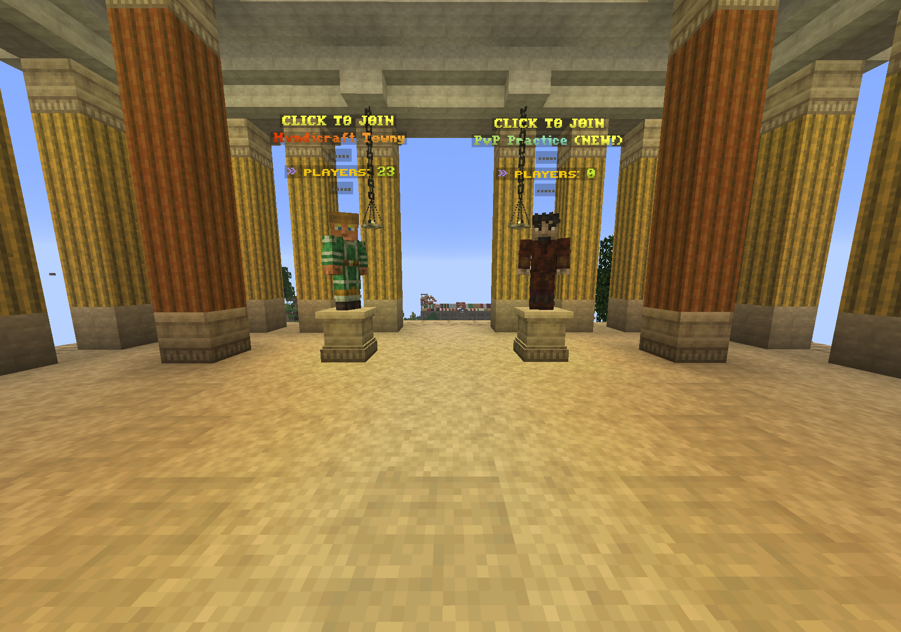
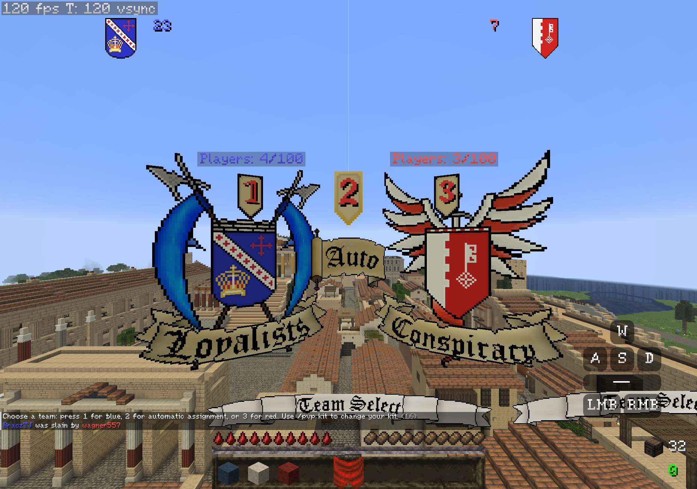
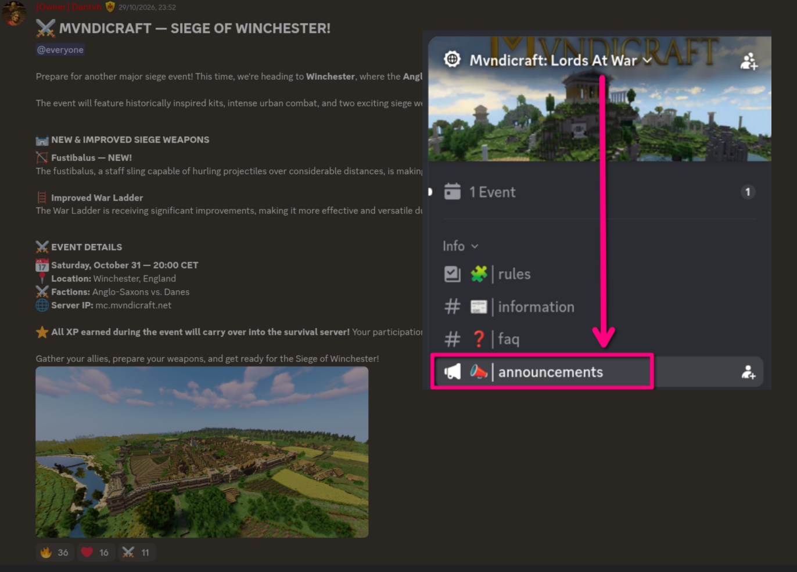

# Game Modes

1. [Mvndicraft Towny Geopol](#mvndicraft-towny-geopol)
2. [PvP Practice](#pvp-practice)
3. [PvP Event](#siege-event)

## Mvndicraft Towny Geopol
The primary experience of Mvndi. Build your town up and fight on a 1:200 map of Europe, North Africa and West Asia. Uses Towny as its territory management system.

To join, interact with the mannequin on the left, or use the compass server selector in your inventory and choose *Eurasia Geopol*, or input the command `/queue survival`.

No further tips here, the vast majority of the wiki is written for this game-mode, [start reading here](guides.md) if you haven't yet.

## PvP Practice

A constant kit PvP battle between two teams. Upon joining, you can choose a team to fight for. Every player is brought to a level ground with the same stats and given a chance to practice PvP with no end, as long as there are other players to fight against.

To join, interact with the mannequin on the right, or use the compass server selector in your inventory and choose *PvP practice*, or input the command `/queue survival`.

Upon joining, you will be prompted to join a team. You can use `/pvp join` to switch teams without quitting the game-mode.

Upon death or when using the command `/pvp kit` you'll be able to choose a kit to fight with. Killing or assisting in kills earns you points, which you can spend on better kits.

To see your stats beyond just the current round, do `/pvp stats`. This will tell you your career lifetime stats: kills, deaths, K/D ratio, and assists.

To spectate you can do `/pvp leave`.

At the end of each round, a vote takes place for the next map.

At any time you can request to duel someone with the `/duel` commands: `/duel request <player>`. You will then be prompted to choose the class that the duel will be held between.

## Siege Event

When announced on the #announcements channel on the [Mvndi Discord](../welcome.md#information), usually on Saturdays without a war session on the [main Mvndicraft Towny server](#mvndicraft-towny-geopol), a siege event takes place. This splits players into two camps with separate kits according to the theme of the team chosen. One camp will be the defenders, with the task to defend their settlement, and the other team will be the assault team. Much like in PvP practice, players are brought to the same stats.

When a siege event is taking place, it will replace the usual PvP practice. To join, interact with the mannequin on the right.

[Attribute XP](guides.md#attribute-xp-in-short) earned by getting kills in this game-mode **transfers** to the main [Mvndicraft Towny server](#mvndicraft-towny-geopol), which is why this is an opportunity not only to practice and get acquainted with the siege weapons, but to grow strong fast. This is why your level from the Geopol gamemode shows even though your stats from the Geopol server are not brought over.